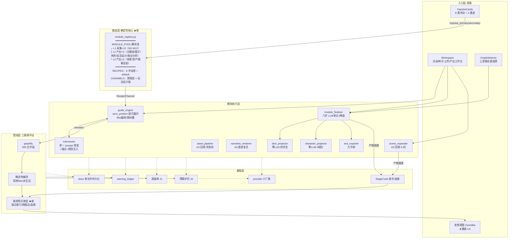
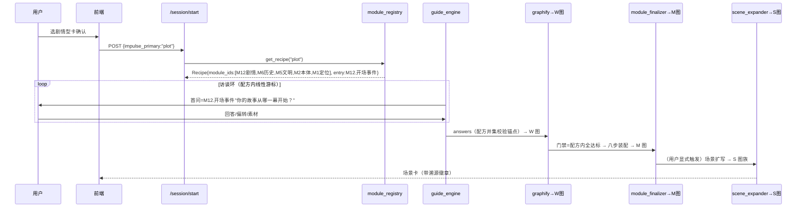
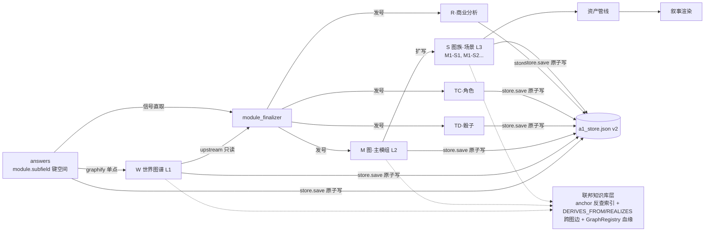

# 甲：模块化架构详细设计 v2

> **v2 变更（2026-09-22 下午）**：并入产品方重锚定四件——①8+2 结构（8 类创作冲动 + 2 条通道，撤销"探索/规则"行）②模块清单 M1-M12 定版（M11 角色/M12 剧情新增，字段集见 `2026-09-22-jia-module-list-expansion.md`）③**L1/L2/L3 内容层级坐标模型**（A1/A2/A3 的本质=层级金字塔而非阶段）④**联邦知识库整合架构 + 剧情三形态 + 溯源 UX**（新增 §5-§7）。
> **定位**：甲计划（`.sisyphus/plans/modular-restructure.md`）的详细设计层——M1-M3 施工图。
> **权威链**：本设计 + D14 为准；与 impulse spec v1.2 冲突处待 v1.3 回写。
> **依据**：三路挖掘（`a2-plan-mining-*.md`）+ A2v0.2/A3 挖掘（`jia-mining-a2v02-and-a3.md`）+ Momus 审查 + 产品方 2026-09-22 重锚定指令。
> **状态**：设计稿（⭐=待产品方终审；代码零改动，等人工审核）

---

## 0. 双轴架构观（先立地基，防混淆）

系统有**两个正交的轴**，所有讨论必须先声明在哪根轴上：

| 轴 | 内容 | 回答什么 |
|---|---|---|
| **运行时五层**（§1） | 入口→路由→模块执行→管线→基础 | 代码怎么组织、调用怎么走 |
| **内容层级 L1/L2/L3**（§6） | 世界层→主模组层→场景层 | 内容在什么细节度上存在、怎么下钻 |

> "A1/A2/A3"的本质 = **L1/L2/L3 内容层级**，不是流水线阶段。旧阶段词汇退役（v6 §3 映射表），层级概念保留并强化。

---

## 1. 架构模块图（运行时五层）

### 1.1 总架构



**关键读法**：路由层是唯一"真相源"；执行层访谈侧复用现有引擎（参数化）、产出侧平移 A2 资产 + 复活 A3 遗迹；**联邦知识库层（§5）是三张图粘合成一个库的粘合剂**。

### 1.2 运行时时序（剧情型会话 → 产出 → 场景下钻）



### 1.3 数据流（单文件 + 联邦视角）



---

## 2. 模块调用方案

### 2.1 注册表解析（一切调用的入口）

```python
# module_registry.py —— 唯一路由真相源（差异是数据不是代码，R2）
class ModuleDef(TypedDict):
    id: str                # 全局唯一中文 id（M1-M12 编号序）
    level: str             # "L1" 采集 | "L2" | "L3" 产出
    family: str            # worldbuilding | story | output
    fields: list[SubField]
    tier: int              # W 图层映射（DN2）
    signal_requirements: dict[str, str]   # 产出模块专用：required/optional/hard

class Recipe(TypedDict):
    impulse_type: str      # 8 型 id 或 "default"
    module_ids: list[str]  # 有序子集（DN1/DN6）
    entry_subfield: tuple[str, str] | None
    anchor: str
    ai_fill_policy: list[str]
    deliverables: list[str]
    guard_flags: list[str]

class Channel(TypedDict):  # 通道与配方分离（8+2 的"2"）
    channel_id: str        # "explore" | "gameplay_line"
    entry: str; flow: list[str]; exit_to: str   # 归宿配方

RECIPES: dict[str, Recipe]     # 8 + default
CHANNELS: dict[str, Channel]   # 2
DEFAULT_RECIPE                 # 原 10 模块全集原序（存量兜底）
```

**调用规则不变**：任何消费方禁止直访 MODULES/MODULE_POOL 全集，必须经 `get_recipe(session)`（六处全集引用改造，甲计划 M1）。

### 2.2 访谈模块调用（L1 采集，同步问答环）

- 单游标线性推进；配方=该会话全集（R6"配方内可达"自动成立）
- 门禁（DN1 默认案）：`∀ m ∈ recipe.module_ids: is_module_over_half(m)`；配方外模块不适用
- 偏转/素材（M0 已上线）：deflect→占位推进；story_material→character_sketch 槽（M11 正式化后迁移入 M11 字段）
- **字段角色标签**（产品方定版）：【输】用户输入｜【锚】AI 演示供验证｜【代】ai_fill｜【抽】原作抽取｜【条】条件激活｜【反】反向抽取——标签进 Recipe 数据，fills/预填引擎按标签分派

### 2.3 产出模块调用（L2/L3，按需触发 + 依赖链）

- 触发：用户显式动作，永不自动触发
- 依赖：`signal_requirements` 声明（required 缺→409 upstream_missing；hard 产物依赖缺→409；optional 缺→保守缺省+ledger 披露）
- 上游只读：upstream_loader 拉已定稿图+answers；stale 不阻断（used_stale 留痕）；文件永不回写图谱
- **L3 特有铁律**（A3 回收）：场景节点只能沿 GEO_CONTAINS 下挂；未生产场景=认知边界外（迷雾）

### 2.4 LLM 生产方封闭清单（DN5）

| 生产方 | 归属 | 产出 | 状态 |
|---|---|---|---|
| interviewer | 访谈引擎 | 回复/fills/建议 | ✅ 存量 |
| inference_pack | M4b 推断包 | 3-5 条推断 | 待 DN5 |
| module_compile | M3 增强线 | 编成文案 | 待 DN5（免费线零 LLM 先行） |
| opening_narrative | 剧情 S1 兑现物 | 200 字开场 | 待 DN5 |
| scene_render | L3 叙事渲染 | 朗读框文本 | 待 DN5（A3 renderer 遗迹复活时立项） |

清单外禁止新增 LLM 调用；"LLM 只产内容与建议，永不产结构/数值/路由"。

---

## 3. 冲动类型 × 模块配方矩阵（8+2 重锚版·⭐ M12 插位待终审）

### 3.1 八条冲动配方（产品方 2026-09-22 定版优先序 + M12 插位提案）

| 配方 | 模块优先序（⭐=M12 插位提案） | anchor | 兑现物 |
|---|---|---|---|
| **设定-重度** | M1轻【输】→M2【输】公理→M3【锚】推演→M7【输】视觉提前→M5【代+确认】→M6【代+确认】公理反推史→M4【代+确认】→M1 完整收口｜M8/M9 意向探测【条】 | 机制自洽 | 世界骨架预览+视觉板 |
| **角色驱动** | M11【输】属性卡→M5【输】冲突=对手→⭐M12【输】命运轨道事件→M6【输】命运轨道→M2【代】舞台→M3轻【输】→M7 角色视觉→其余【代】 | 命运导向 | 速写卡+弧光轨道图 |
| **剧情** | ⭐M12【输】开场事件+抉择→M6【输】关键节点（背景）→M5【输】冲突→M2【代】解释→M3/M4【代】阻力→⭐M12 分支树【锚】收口→M1【代+确认】 | 节奏导向 | 开场叙事段+时间线可视化 |
| **哲理** | M2【输】公理→M5【输·绑定共现】信奉者/违反者→M3【输】代价面→M6【代】违规史→M1【代+确认】 | 追问违反后果 | 公理卡+思想实验切片（⭐落 M12.剧情切片） |
| **爱情** | M11【输】双人关系卡→M1【输】套路库→⭐M12【输】情感线事件（opening=相遇/tension=情感阻力）→M7【输】氛围+角色视觉→M3/M4/M5【代】阻力素材库｜M10 强化 preset | 情感张力 | 双人速写卡+初见场景（content_guard 同批强制） |
| **怀旧** | M10【输】先行 canon 锁定→上传→M1-M9 全量【抽】→差额访谈【输·仅缺失冲突项】→确认页 | 风格保真 | "它认出了你的世界" |
| **疗愈** | 种子直达（零采集）→M1【输】仅命名权→M2-M9【代·不可见】｜M10 全代填 | 陪伴低压力 | 现成世界+共写 |
| **说不清** | ⭐M12轻【输】单问启动→M5/M2/M3/M4【代·推断包】→三值判定→迁移（字段全量继承） | 中性引导 | 推断包+迁移 |
| default | 原 10 模块原序（无 profile 兜底） | — | 通用图谱 |

### 3.2 两条通道（CHANNELS）

| 通道 | 流程 | 归宿 |
|---|---|---|
| **探索态**（着陆状态非冲动） | 着陆页→B 类合规能力演示（文风/格式/一致性/多方案）→三选一 demo | 导入 8 类之一；A 类请求统一拒绝+计数 |
| **玩法设计链**（下游产线） | 目的地 flag（设定-重度变体，M3 切机制向采集）→IP 资产包→载体决策（TRPG/电子游戏/互动小说/卡牌战棋，显式选择）→**M8+/M9+ 完整形态（按载体分支 schema）**→机制-世界观一致性回查（反向：从机制查公理） | L2 玩法设计完整形态产物 |

### 3.3 三条全局规则 + 优先级语义

1. **M10 永远在场**：不进优先序，全局层常驻；疗愈（全代填）/爱情（强化）/怀旧（先行）三 preset
2. **M8/M9 条件激活**：仅玩法目的地型完整展开，其余七类收缩为一句意向探测（答"是"存 flag 导入玩法链）
3. **迁移继承**：说不清迁移/探索态导入/玩法 flag 转正——已采集/已推断/已纠正字段**无损带入**（纠正记录=冲动坐标行为证据）
4. 序即优先｜子集即边界（DN1）｜动态三杠杆只调未访模块（四护栏之②）

---

## 4. 单文件落盘结构（不变，微注）

§4.1-4.3 维持 v1 设计（store v2 schema / 防乱三机制 / 零迁移兼容），两处补充：
- `answers` 键空间现含 M11/M12 键（如 `剧情.开场事件`、`角色.欲望`）——中文 id 全局唯一防撞机制不变
- `artifacts` 产物槽扩至五键：`dice_template / character_template / module_doc / gameplay_package（玩法完整形态）/ analysis_report（商业分析 R）`；L3 场景族独立挂 `scenes: {"M1-S1": {...}}`（S 码实例键控，同一模块多场景）

---

## 5. 联邦知识库整合架构（v2 核心升级）

**问题**：12 采集模块 + 8 产出模块的内容，怎么**有机整合到一个知识库**？

### 5.1 模型：一个知识库 = 锚点贯通 + 三层图联邦 + 三种连接

```
┌─────────────── 知识库（一个 store + 一个 GraphRegistry + 跨图边层）──────────────┐
│   W 世界图(L1)        M 图族(L2)                S 图族(L3)                        │
│  ┌───────────┐  DERIVES_FROM  ┌────────────┐  REALIZES  ┌────────────┐          │
│  │ M1..M12   │ ────────────→ │ 主模组 M    │ ────────→ │ M1-S1 场景  │          │
│  │ 模块子树    │  (信号溯源边)  │ TD/TC/R    │  (下钻边)  │ M1-S2 ...  │          │
│  │ d:条目     │ ←──────────── │ source_    │           │ atmosphere │          │
│  │ cst_*     │  anchors[]    │ anchors[]   │           │ 朗读框候选  │          │
│  └───────────┘               └────────────┘           └────────────┘          │
│       ↑SEMANTIC（LLM 提议→confirm→转正）                                        │
│   M12.线索链 ──────→ M11.人物条目                                                │
│   GraphRegistry：全部图户口本（StageCode + parent 血缘 + stale 传播）              │
└──────────────────────────────────────────────────────────────────────┘
```

**为什么联邦不合并成一张大图**：W 一变不该重写 M/S；层间 stale 粒度不同；每图独立保三铁律与确定性。**统一视图在查询时组装**，不落盘 blob。

### 5.2 三种连接机制（"有机"的来源，按可信度排序）

| # | 机制 | 生成 | 例 |
|---|---|---|---|
| 1 | **结构连接**（TREE/GEO_CONTAINS） | 确定性，零 LLM | M11 人物子树；场景沿 GEO_CONTAINS 挂 M4 地理节点 |
| 2 | **投影连接**（DERIVES_FROM ★新边型） | 确定性，finalize 生成 | TD 节点带 source_anchors=[骰子设定.概率, 力量体系.代价]——signal_sources 即边清单 |
| 3 | **语义连接**（SEMANTIC，已有机制扩展） | LLM 提议→审核→转正 | M12.线索链"寻找妹妹"↔M11.人物"小雪"；确认边才入正典 |

**边型封闭枚举扩展**：TREE | CROSS | SEMANTIC | RULE | STRUCTURE（存量）+ **DERIVES_FROM | REALIZES**（联邦层专用）——枚举扩展走 D14 台账。

### 5.3 锚点公律（全库唯一连接键）

> 任何层级的任何节点必须携带 `anchor`/`source_anchors` 溯源到喂养它的采集字段。

由此获得贯通查询：任意节点→上溯采集现场（哪个模块哪个问题+用户原话）→或下钻最终产物（哪张骰子/哪幕场景）。**"有机整合"的可操作定义=锚点可贯通 + 三种连接可遍历 + 血缘可传播。**

### 5.4 防乱五防线（v1 保留，第 3 条升级）

1. 锚点校验=配方并集（graphify）｜2. 家族-tier 固定映射（DN2：M12→历史线层/M11→文明层）｜3. **产物图谱独立命名空间+联邦血缘**（升级：跨图边在联邦层，不入 W 图）｜4. 确定性装配不变式（同配方同答案→逐字节同图）｜5. 跨配方不比较

### 5.5 契约测试扩展

C3 配方子集版｜C8 确定性快照（10 配方 fixture）｜C9 产物隔离（W 中永不出现 M/TD/TC/S 节点）｜**C10（新）：跨图边合法性**——DERIVES_FROM 的 anchor 必存在于源图答案集（防幻影引用）

---

## 6. 模块 × 层级坐标模型（L1/L2/L3）

### 6.1 三层金字塔与下钻

```
L3 场景层（原 A3）：一幕戏/判决/朗读框——实际演出
  ↑ REALIZES（血缘下钻 + ScopeBoundary 继承）
L2 主模组层（原 A2）：可开团完整内容包——可玩骨架
  ↑ DERIVES_FROM（信号读取，上游只读）
L1 世界层（原 A1）：世界观底座 + 用户意向——事实素材
全局层（贯穿）：M10 内容授权域 + ScopeBoundary 结构活动域
```

### 6.2 完整模块坐标表

| 坐标 | 模块 | 数量 |
|---|---|---|
| L1·采集 | M1 定位/M2 本体/M3 力量/M4 地理/M5 文明/M6 历史/M7 视觉/M8 玩法DNA【条】/M9 骰子【条】/M10 边界【全局】/M11 角色/M12 剧情 | 12 |
| L2·产出 | ①主模组文字版(M码) ②骰子投影(TD) ③角色投影(TC) ④**玩法设计完整形态**（载体分支 schema） ⑤**商业分析报告**(R码，RAG 三库喂料) | 5 |
| L3·产出 | ⑥场景扩写(S码) ⑦资产管线（状态机 pending→generating→pending_review→approved/rejected） ⑧叙事渲染（renderer 遗迹复活） | 3 |
| 通道 | 探索态（着陆）/ 玩法设计链（L1 flag→L2 产线） | 2 |
| 全局 | M10 授权域 + ScopeBoundary 结构域（双层边界，归并方案⭐待裁决） | 2 |

### 6.3 剧情三形态（同一条故事线的四个粒度）

| 粒度 | 载体 | 内容 | 术语 |
|---|---|---|---|
| 用户意向 | **M12**（L1） | 开场事件/抉择/线索链——"我想讲的故事" | 剧情意向 |
| 历史背景 | M6.主剧情（L1） | 世界历史脉络——大背景板 | **主剧情**（历史脉络义） |
| 模组骨架 | **L2 主模组**主线冲突+叙事相位锚点 | 结构洞/钩子/成功失败树——可玩故事结构 | **主线冲突**（A2 原名） |
| 场景演出 | **L3 场景** | 一幕戏/判决分支/朗读框 | **场景事件** |

**术语纪律**：系统词汇表四名分离（剧情意向/主剧情/主线冲突/场景事件）——用词即分层；三张图里是**三个不同节点**（非拷贝），靠血缘边相连，id 体系（`模块.字段`/`d:` vs `M码` vs `S码`）+ `role: source_material|story_skeleton|performance` 标签保证系统永不混淆。

---

## 7. 溯源 UX（用户体验层）

### 7.1 五触点

1. **输入瞬间**：回复卡微反馈"✓ 已记入【M6·主剧情】——将驱动：图谱条目·主模组剧情章节·场景灵感"（建心智模型）
2. **图谱页**："只看我的输入"过滤器（锚定节点高亮）+ 节点详情面板加"来源"段（📝 用户原话逐字引用 + 🔗 被引用 N 处）
3. **被引用清单**（核心）：按层级分组 [W]/[M]/[S] 徽章——W 深度条目×N/语义边；M 第几节剧情弧/角色卡锚；S 哪个场景——每条可点跳转
4. **产物侧源徽章**：主模组章节卡/骰子卡/场景卡带 `源` 徽章，hover 显示"源自你的：主剧情+北境地形+小雪"（产物自己交代出身）
5. **影响预览**：改答案定稿前弹"本次修改将使过期：主模组 v1·场景×2·角色卡×1"（stale 传播的 UX 化）

### 7.2 变焦滑杆（一条故事线三层看）

选任一剧情线索→同屏三层展开，各带层级徽章+血缘箭头可跳转：

```
🔍 妹妹失踪
├─ [W·素材] "雪原上妹妹失踪了"（你的原话 · 背景：北境百年战争）
├─ [M·骨架] 主线冲突「寻妹 vs 极寒反噬」·成功树/失败树（IP3-M1-v1）
└─ [S·演出] 场景「雪原黄昏」·判决分支·朗读框（IP3-M1-S1-v1）
```

**设计原则**：正向（输入→下游）微反馈建预期；反向（节点→来源）徽章+面板交代出身；修改前影响预览兜底——**用户不需要懂知识图谱也能获得知识图谱的可信度**。

### 7.3 技术支撑（全部就绪，只缺组装）

source_anchors（A2 设计已有）｜d:{anchor} 节点（已有）｜NodeDetailPanel（已有，加来源段）｜**引用反查索引**（新增件：finalize 时确定性构建 anchor→refs[]，纯代码）｜stale 血缘（已有）

---

## 8. 与既有文档的落位关系

| 文档 | 关系 |
|---|---|
| 本设计 v2 | 甲计划 M1-M3 施工图 + 知识库/UX 设计权威 |
| `2026-09-22-jia-module-list-expansion.md` | M12 字段集细节 + A2/A3 提取证据（本文 §6.2 引用） |
| SYSTEM_DESIGN_SPEC_v6 | 规范层——**待同步**：模块池数量/8+2/联邦边型/L2 产出五件（同步待指令） |
| impulse spec v1.3（G 批次） | 路由表按 8+2 重写（数据源=本文 §3.1） |
| 甲计划 | M2 任务卡待按 M11/M12 重写（待指令） |
| decision-log | 8+2 重锚 + 联邦知识库裁决待补条（随 v1.3 批次） |
